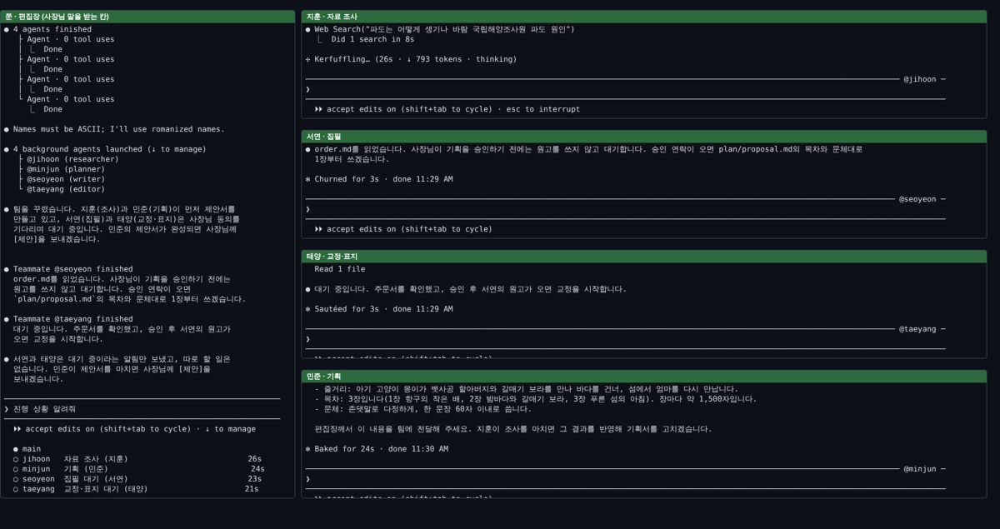
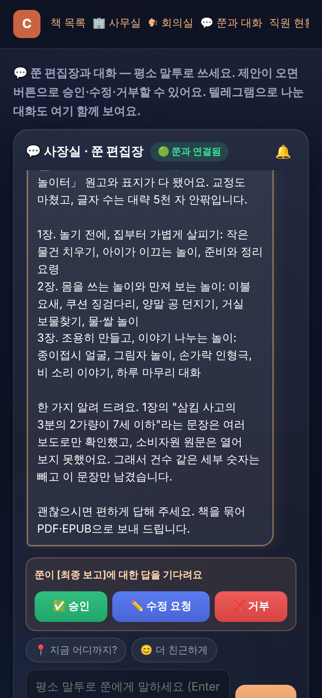
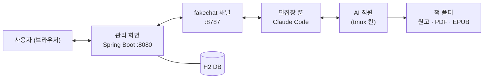

# 1인 AI 출판사

웹 대화방에 평소 말투로 "이런 책 만들어 줘"라고 주문하면, AI 편집장과 AI 직원들이 역할을 나눠 전자책(PDF·EPUB)을 만드는 시스템입니다.

## 화면

아래는 시연 화면입니다.

### 사무실: 에이전트 작업 상황


### 회의실: 에이전트가 주고받는 메시지


### 대화방: 주문, 제안, 거부


### 터미널: tmux 칸으로 보는 에이전트 팀


### 좁은 화면


## 동작 흐름



1. 사용자가 대화방에서 책을 주문합니다.
2. 편집장 에이전트가 팀을 꾸려 일을 나눕니다.
3. 기획안이 오면 사용자가 승인, 수정 요청, 거부 중에서 답합니다.
4. 승인하면 집필, 교정, 표지 작업을 진행합니다.
5. 최종 승인 후 PDF와 EPUB을 만들어 전달합니다.

휴대폰 텔레그램 연결은 선택 기능입니다.

## 에이전트 구성

| 이름 | 역할 | 정의 파일 |
|---|---|---|
| 쭌 | 편집장 (팀장) | `publisher-kit/CLAUDE.md` |
| 민준 | 기획 | `publisher-kit/.claude/agents/planner.md` |
| 지훈 | 자료 조사 | `publisher-kit/.claude/agents/researcher.md` |
| 서연 | 집필 | `publisher-kit/.claude/agents/writer.md` |
| 태양 | 교정·표지 | `publisher-kit/.claude/agents/editor.md` |
| 테포 | 배포·서버 | `publisher-kit/.claude/agents/devops.md` |

직원 명부는 `publisher-kit/staff.yml`에서 관리합니다.

## 기술 스택

| 구분 | 사용 기술 |
|---|---|
| 관리 화면 | Java 21, Spring Boot 3.4.5, Spring MVC, REST API, Spring Data JPA, Thymeleaf, JavaScript |
| 데이터베이스 | H2 (로컬), MySQL (서버 설정) |
| AI | Claude Code 에이전트 팀, fakechat 채널 플러그인 |
| 실행 환경 | WSL2 Ubuntu, tmux |
| CI | GitHub Actions |

## 폴더 구조

```
publisher-dashboard/   관리 화면 소스 (Spring Boot)
publisher-kit/         에이전트 정의, 운영 규칙, 실행 스크립트, 배포 스크립트
setup-publisher.sh     설치 스크립트
docs/images/           README 이미지
```

## 실행 방법

준비물: WSL2 Ubuntu, Java 21(JDK), tmux, unzip, python3, Bun, Claude Code(유료 구독 필요)

```bash
# 1. 관리 화면 빌드
cd publisher-dashboard
chmod +x gradlew
./gradlew bootJar

# 2. 설치 스크립트가 찾는 위치로 복사
cp build/libs/publisher-dashboard.jar ../
cd ..

# 3. 설치
bash setup-publisher.sh
```

새 터미널을 열고 `출근`을 입력한 뒤 브라우저에서 `http://localhost:8080`에 접속합니다.

> 위 순서는 설치 스크립트를 읽고 정리한 것으로, 새 PC에서 처음부터 실행해 검증하지는 않았습니다.

---

> **참고:** 교육 과정의 실습 자료(코드·시연 화면)를 바탕으로 구성한 프로젝트입니다.
